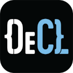

# DeclLang

|  | **In active (heavy) development** |
| ------------------------------------------------------------ | --------------------------------- |


Decl is a dynamically-typed programming language that ***transpiles*** into a C++ API, implemented from scratch.

The primary idea is source-to-source (ahead of time) compilation. At the same time, there is also a subset of the language that runs at runtime - as an interpreter. This enforces Decl to be a language that can be run both via a VM at runtime and natively at compile time. The compiler frontend and the language backend themselves have no dependencies.


The runtime version of the language allows the developer to rapidly run and test their programs without heavy optimizations, which enables rapid development with the concept of **_"Only build your code for production when you need to"_**.


## Compiler Frontend and Optimizations

The language is built based on the idea that it is not just another compiler or lexer - it is implemented from scratch, independently with the focus on high performance and portability. This way, by fully grasping the implementation of the language itself, this allows full control over the language where every single (frontend and backend) component demands attention to detail and can be optimized to its fullest potential.

The parsing implements the [recursive descent](https://en.wikipedia.org/wiki/Recursive_descent_parser) approach/algorithm.


## REPL - Interactive Shell

Decl supports the interactive shell that allows developers to run and test any Decl code on the fly.


## C++ Motivation

The motivation for most (if not all) of my research content is inspired by Decl as I have made most of these performance improvements during the development, designing, testing, and debugging of Decl. It has been a 2+ year progress as once you came up with a design, you are pretty much stuck with it forever, especially with the main focus on high performance.

To check out my YouTube channel, please visit: https://www.youtube.com/@AlexMilenkovic-ks7xd

The source code from the videos is published at https://github.com/BeAllAround/S2S-Compilers-Blog-Series-Public; related write-ups on https://dev.to/alex01.


## Why C++11 Standard for Decl?

While C++20 introduces powerful features such as `constinit` and `consteval`, which could improve the quality of the generated code, Decl deliberately avoids depending on the latest language standards.

There are three primary reasons for this decision:

- First, heavier use of new C++ features tends to increase backend compilation/build times, as modern compilers must perform more complex analysis and template instantiation.

- Second, supporting a wide range of C++ standards (C++11 and later) improves compatibility and portability for users. The Decl compiler can generate code compatible with older standards while still allowing users who desire newer features to benefit from them through their chosen C++ compiler if they take the liberty of modifying the destination source.

- Third, the Decl frontend compiler must generate clear, high-level errors itself rather than relying on the backend C++ compiler to generate those errors. Every time we leverage a particular C++ feature, the Decl compiler has to fully enforce all of its rules and constraints. In practice, this significantly increases maintenance burden and dramatically raises the overall complexity of the Decl compiler.

The focus of future work remains on strengthening the Decl compiler itself. The goal is that **"Any optimization that _can be_ performed reliably at Decl compile time should be done there"**. If an effect can be achieved using C++11, there is little reason and motivation to rely on newer, more complex language features that would burden the backend compiler and, ultimately, reduce portability.

Ultimately, whenever we optimize C or C++ code, we must examine the generated assembly. No matter how high-level the language appears, it is the low-level machine code that ultimately determines performance. This principle is shared by every programming language: the final arbiter is the machine itself. *In programming, the machine is the judge — humans are only the jury*.


## Usage Reference

It is important to note that the semi-colon is optional, and is used by developers to mark the end of an expression for code readability. This gives the developer a flexible choice - use a semi-colon if desirable, or prefer the new line `\n` as the end of a definition or expression.


### Define a variable

```javascript
decl a = 1;
decl str = "MyDeclString";
decl arr = [1, 2, 3]; // Array Definition
decl hash_table = {'a': 1, 'b': 2 }; // Hash Table (Dictionary) Definition
```

Types like Array and HashTable are dynamic types and can also be used as expressions.


### While Loop

```javascript
decl i = 0;
while(i < 10) {
    sys.print(i);
    i++;
}
```


### Define a function

```javascript
func f1(a, b) {
    return a + b;
}
```


### Short-circuit Evaluation

When it comes to logical operators, Decl implements the short-circuit evaluation for the logical `AND(&&)` and `OR(||)` operators.

```javascript
func func1() {
    sys.print("func1() called!");
    return 0;
}

func func2() {
    sys.print("func2() called!");
    return 0;
}

decl a = 0 || 2; // Holds 2

// Note: "func1() called" printed. In which case, the func2() call is never evaluated
decl output = func1() && func2();
```


### Built-In Functions and Namespaces

Decl comes with the ready-to-use bundle of standard libraries used for general purpose programming.

These include the following:

- `sys.print(Value...)` - Print your Decl Value to the system I/O


